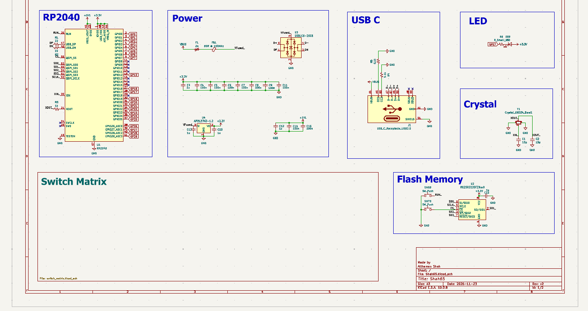
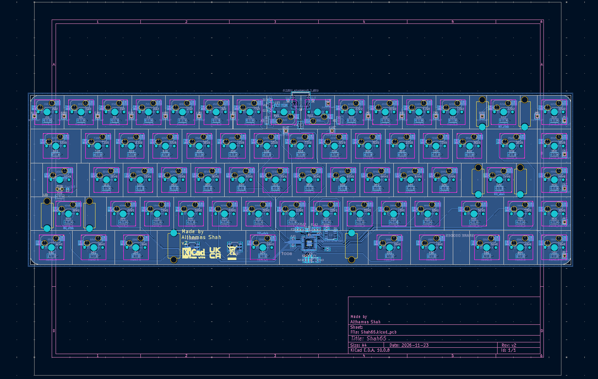

## Shah65
A custom 65% compact, minimalist, aesthetic & cute mechanical keyboard, Uses RP2040 as the MCU and Kalih Hot-swapable sockets.

65% layout
Hot-Swappable Switches
Middle Type C port
Lock and Snap in fit Case

### Schematic

### PCB

### 3D case
Onshape: [Link](https://cad.onshape.com/documents/f1803f145455ec0103fb0303/w/ed14bef00e1f0e3e76f49260/e/63a18fe0a0e5d5b9d507f784?renderMode=0&uiState=6b055399905bbdc01cb6fa95)

### BOM

| PART | TYPE | QUANTITY | UNIT PRICE (USD) | LINE TOTAL (USD) | LINK | VENDOR | Funding | Notes |
|---|---|---:|---:|---:|---|---|---|---|
| Shah65_v2_Y4 | PCB | 5 | $8.96 | $44.80 | [JLCPCB](https://jlcpcb.com/) | JLCPCB | Grant | Order Y4-13855454A; green, 1.6 mm thickness, OSP; shipping excluded. |
| Shah65_v2_Y4 | PCB | 2 | $27.12 | $54.24 | [JLCPCB](https://jlcpcb.com/) | JLCPCB | Grant | SMT026112263954-138...; assemble bottom side; shipping excluded. |
| Akko Botany Switch Pack (45) | Part | 2 | $12.94 | $25.88 | [Stackskb](https://stackskb.com/store/akko-botany-switch-pack-of-45/) | Stackskb | Already own | INR converted at 1 INR = $0.01079 (2026-11-20). |
| Sikakeyb Doubleshot PBT Keycaps (Two Tone White and Green) | Part | 1 | $23.74 | $23.74 | [Stackskb](https://stackskb.com/store/sikakeyb-doubleshot-pbt-keycaps-two-tone-white-and-green/) | Stackskb | Grant | INR converted at 1 INR = $0.01079 (2026-11-20). |
| Shipping | Shipping | 1 | $2.00 | $2.00 |  | Stackskb | Grant | |
| **Total** |  |  |  | **$150.66** |  |  |  |  |
| **Grant total** |  |  |  | **$124.78** |  |  |  |  |

Download the [BOM as CSV](BOM.csv).

### License
[MIT LICENSE](/LICENSE)